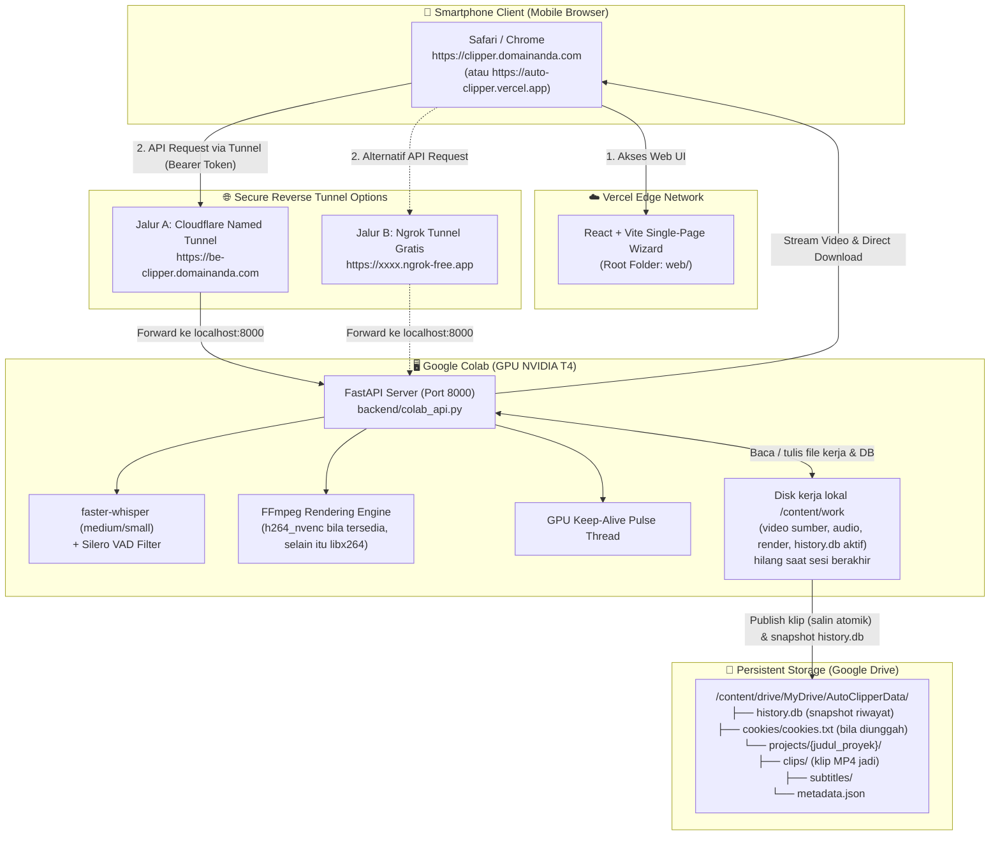
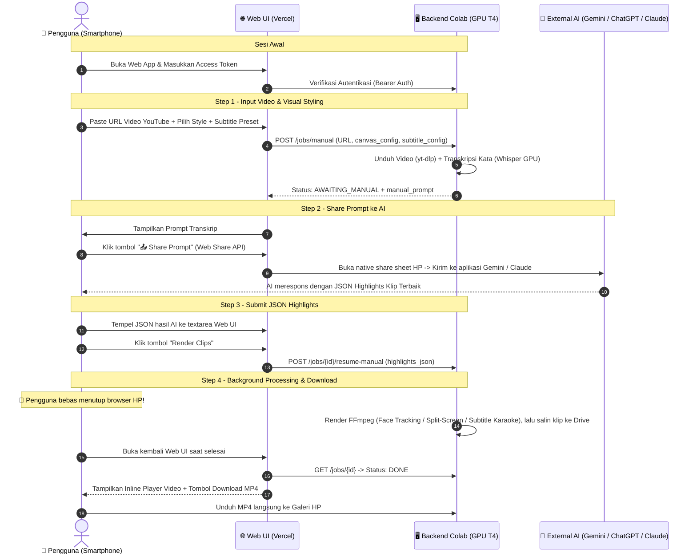

# ☁️ Panduan Teknis Lengkap: Menjalankan Auto Clipper Cloud

Dokumentasi ini merupakan panduan teknis resmi *end-to-end* untuk mengonfigurasi, mendeploy, dan mengoperasikan **Auto Clipper Cloud secara mandiri (*self-hosted*)**.

Dengan panduan ini, Anda dapat menjalankan seluruh proses berat (transkripsi suara dengan Whisper, *face tracking*, pembuatan kanvas dinamis, dan *rendering* video FFmpeg) di **Google Colab (T4 GPU Gratis)** dengan penyimpanan persisten di **Google Drive**, serta mengontrolnya langsung dari **Web App Smartphone (Vercel)**.

Transkripsi Whisper memakai GPU T4. Notebook memasang FFmpeg standar dari Ubuntu, jadi render memakai encoder GPU (`h264_nvenc`) hanya bila runtime Colab menyediakannya; bila tidak, render berjalan di CPU (`libx264`). Encoder yang benar-benar dipakai tertulis di Pemeriksaan awal (Langkah 3.4) dan di "Detail waktu" setiap job.

> [!NOTE]
> **Pilihan Metode Konektivitas (Pilih Sesuai Kebutuhan Anda):**
> 1. **Jalur A (Rekomendasi jika Punya Domain Pribadi):** Menggunakan **Cloudflare Zero Trust Named Tunnel** (`be-clipper.domainanda.com`) + Custom Domain di Vercel (`clipper.domainanda.com`).
> 2. **Jalur B (100% Gratis Tanpa Punya Domain):** Menggunakan **Ngrok Tunnel** (`https://xxxx.ngrok-free.app`) + Domain default gratis Vercel (`https://auto-clipper-web-xxxx.vercel.app`).

---

## 📑 Daftar Isi

1. [Ikhtisar & Arsitektur Sistem](#1-ikhtisar--arsitektur-sistem)
   - [Diagram Aliran Data & Topologi](#diagram-aliran-data--topologi)
   - [Keunggulan Mode Cloud](#keunggulan-mode-cloud)
2. [Prasyarat & Persiapan Akun (One-Time Setup)](#2-prasyarat--persiapan-akun-one-time-setup)
3. [Setup Backend Cloud (Google Colab & Google Drive)](#3-setup-backend-cloud-google-colab--google-drive)
   - [Langkah 3.1: Membuka Notebook Colab](#langkah-31-membuka-notebook-colab)
   - [Langkah 3.2: Mengaktifkan Akselerator Hardware T4 GPU](#langkah-32-mengaktifkan-akselerator-hardware-t4-gpu)
   - [Langkah 3.3: Mounting Google Drive & Struktur Workspace](#langkah-33-mounting-google-drive--struktur-workspace)
   - [Langkah 3.4: Eksekusi Server & Mekanisme GPU Keep-Alive](#langkah-34-eksekusi-server--mekanisme-gpu-keep-alive)
   - [Langkah 3.5: Verifikasi Health Check Backend](#langkah-35-verifikasi-health-check-backend)
4. [Setup Konektivitas Tunnel Publik](#4-setup-konektivitas-tunnel-publik)
   - [Jalur A: Cloudflare Zero Trust Tunnel (Jika Punya Domain Sendiri)](#jalur-a-cloudflare-zero-trust-tunnel-jika-punya-domain-sendiri)
   - [Jalur B: Ngrok Tunnel Gratis (Jika Tidak Punya Domain)](#jalur-b-ngrok-tunnel-gratis-jika-tidak-punya-domain)
5. [Setup & Deployment Frontend Web ke Vercel](#5-setup--deployment-frontend-web-ke-vercel)
   - [Langkah 5.1: Import Repositori ke Vercel](#langkah-51-import-repositori-ke-vercel)
   - [Langkah 5.2: Konfigurasi Root Directory & Build Settings](#langkah-52-konfigurasi-root-directory--build-settings)
   - [Langkah 5.3: Pengaturan Environment Variable (VITE_API_URL)](#langkah-53-pengaturan-environment-variable-vite_api_url)
   - [Langkah 5.4: Pengaturan Domain Frontend (Custom Domain vs Default Vercel)](#langkah-54-pengaturan-domain-frontend-custom-domain-vs-default-vercel)
6. [SOP Pengoperasian Harian via Smartphone (4-Step Wizard)](#6-sop-pengoperasian-harian-via-smartphone-4-step-wizard)
   - [Langkah 0: Inisialisasi Sesi & Login](#langkah-0-inisialisasi-sesi--login)
   - [Step 1: Input URL & Pemilihan Gaya Video](#step-1-input-url--pemilihan-gaya-video)
   - [Step 2: Transkripsi Whisper & Share Prompt ke AI](#step-2-transkripsi-whisper--share-prompt-ke-ai)
   - [Step 3: Submit JSON Highlights dari AI](#step-3-submit-json-highlights-dari-ai)
   - [Step 4: Background Rendering & Download MP4](#step-4-background-rendering--download-mp4)
7. [Panduan Pemeliharaan, Troubleshooting & FAQ](#7-panduan-pemeliharaan-troubleshooting--faq)
   - [Kendala 1: Sesi Google Colab Terputus / Idle Timeout](#kendala-1-sesi-google-colab-terputus--idle-timeout)
   - [Kendala 2: Error 401 Unauthorized / Token Mismatch](#kendala-2-error-401-unauthorized--token-mismatch)
   - [Kendala 3: Error CORS atau Network Connection Failed](#kendala-3-error-cors-atau-network-connection-failed)
   - [Kendala 4: Memory GPU Penuh (OOM) & Fallback Otomatis NVENC](#kendala-4-memory-gpu-penuh-oom--fallback-otomatis-nvenc)
   - [Kendala 5: Manajemen & Pembersihan Kapasitas Google Drive](#kendala-5-manajemen--pembersihan-kapasitas-google-drive)
   - [Kendala 7: "YouTube meminta verifikasi"](#kendala-7-youtube-meminta-verifikasi-sign-in-to-confirm-youre-not-a-bot--http-403)
   - [Kendala 8: Job Tertahan dengan Tulisan "Menunggu giliran"](#kendala-8-job-tertahan-dengan-tulisan-menunggu-giliran)
   - [Kendala 9: "Google Drive belum terhubung"](#kendala-9-google-drive-belum-terhubung)

---

## 1. Ikhtisar & Arsitektur Sistem

Auto Clipper Cloud memisahkan antarmuka pengguna (*Frontend*) dengan mesin komputasi berat (*Backend*). Pengguna mengontrol alur kerja dari browser smartphone (iOS Safari / Android Chrome) yang di-host di Vercel, sementara pemrosesan AI dan video dioperasikan di VM Google Colab yang dilengkapi GPU NVIDIA T4.

### Diagram Aliran Data & Topologi



### Keunggulan Mode Cloud

1. **Bebas Kebutuhan Spesifikasi Komputer**: Tidak memerlukan PC gaming atau kartu grafis mahal. Cukup gunakan HP dengan koneksi internet.
2. **GPU T4 Gratis untuk Transkripsi**: Whisper berjalan di GPU, jauh lebih cepat daripada di CPU. Render klip memakai GPU hanya bila runtime menyediakan encoder `h264_nvenc` (lihat Pemeriksaan awal).
3. **Disk Kerja Cepat, Hasil Aman di Drive**: Selama job berjalan, semua file dikerjakan di disk lokal Colab (`/content/work`). Setiap klip yang selesai langsung disalin ke Google Drive, dan riwayat (`history.db`) dicadangkan ke Drive. Jika sesi Colab terputus, klip jadi dan riwayat tetap ada, dan job bisa dilanjutkan (*resume*); video sumber diunduh ulang bila diperlukan.
4. **Alur Kerja Asinkron (*Bebas Tutup Browser*)**: Saat FFmpeg merender klip di Colab, Anda dapat menutup browser smartphone dan melakukan aktivitas lain. Ketika browser dibuka kembali, sistem akan menyinkronkan status secara otomatis.

---

## 2. Prasyarat & Persiapan Akun (One-Time Setup)

Sebelum menjalankan Auto Clipper Cloud untuk pertama kali, siapkan akun dan token berikut:

| Komponen | Kegunaan | Biaya | Pendaftaran |
|---|---|---|---|
| **Akun Google** | Akses Google Colab & Google Drive | Gratis (15 GB) | [google.com](https://google.com) |
| **Akun GitHub** | Repository hosting kode Auto Clipper | Gratis | [github.com](https://github.com) |
| **Akun Vercel** | Hosting antarmuka Frontend Web | Gratis (Hobby Tier) | [vercel.com](https://vercel.com) |
| **Cloudflare Zero Trust** *(Jalur A)* | Tunnel aman jika punya custom domain | Gratis (Free Tier) | [dash.cloudflare.com](https://dash.cloudflare.com) |
| **Akun Ngrok** *(Jalur B)* | Tunnel instan jika tidak punya domain | Gratis (Free Tier) | [ngrok.com](https://ngrok.com) |

> [!IMPORTANT]
> **Tentukan Static API Secret Token Anda:**
> Siapkan sebuah kata sandi rahasia yang kuat (misalnya: `rahasia-saya-2026-xyz`). Token ini akan digunakan bersama antara Colab Backend (`API_SECRET_TOKEN`) dan Web App di HP Anda untuk mencegah akses tanpa izin dari publik.

---

## 3. Setup Backend Cloud (Google Colab & Google Drive)

### Langkah 3.1: Membuka Notebook Colab

1. Buka [Google Colab](https://colab.research.google.com/).
2. Pilih tab **GitHub**, masukkan URL repository Anda (atau upload file [`Auto_Clipper_Colab.ipynb`](../Auto_Clipper_Colab.ipynb)).
3. Buka file **`Auto_Clipper_Colab.ipynb`**.

### Langkah 3.2: Mengaktifkan Akselerator Hardware T4 GPU

1. Pada menu navigasi Colab, klik **Runtime** $\rightarrow$ **Change runtime type** (*Ubah jenis runtime*).
2. Di bagian **Hardware accelerator**, pilih **T4 GPU**.
3. Pastikan indikator **GPU RAM** muncul di status bar kanan atas.

> [!WARNING]
> Jika runtime berjalan pada mode standard **CPU**, transkripsi Whisper berjalan jauh lebih lambat. Pemeriksaan awal di Langkah 3.4 menandainya dengan `[PERHATIAN] GPU tidak aktif`.

### Langkah 3.3: Menghubungkan Google Drive & Mempersiapkan Ruang Kerja

Di Google Colab, setiap instruksi kode berada di dalam **kotak eksekusi**. Anda cukup mengklik **tombol Play (▶️)** di sebelah kiri masing-masing kotak:

1. **Hubungkan Google Drive (Kotak Bagian 1):**
   - Klik tombol **Play (▶️)** pada bagian **`1. Mount Google Drive`**.
   - Colab akan menampilkan tombol persetujuan *"Connect to Google Drive"*. Klik tombol tersebut dan izinkan akses akun Google Anda.
   
   Setelah terhubung, Auto Clipper memakai dua tempat penyimpanan:
   ```text
   Disk kerja lokal Colab: /content/work/        # cepat, HILANG saat sesi berakhir
   ├── history.db                  # Database riwayat yang sedang dipakai server
   ├── temp_downloads/             # Video yang diunggah langsung lewat /upload
   └── projects/{judul_proyek}/
       ├── source/                 # Video asli (unduhan atau salinan dari Drive)
       ├── subtitles/              # Transkrip kata & subtitle kerja
       └── clips/                  # Klip yang sedang dirender

   Google Drive Saya / AutoClipperData /         # permanen (pustaka)
   ├── history.db                  # Snapshot riwayat: status akhir job langsung, perubahan lain maks. 1x per 5 detik
   ├── cookies/cookies.txt         # Hanya bila Anda mengunggah cookies YouTube
   └── projects/{judul_proyek}/
       ├── clips/                  # Klip video hasil render siap unduh
       ├── subtitles/              # Transkrip kata & subtitle hasil edit
       └── metadata.json           # Ringkasan job (tanpa API key)
   ```

   Video sumber tidak disalin ke Drive. Bila sesi berakhir lalu job dilanjutkan atau dirender ulang, video dari URL diunduh ulang dan video yang dipilih dari Google Drive disalin ulang dari Drive. Video yang diunggah langsung harus diunggah lagi.

### Langkah 3.4: Memasang Program & Menjalankan Server Backend

2. **Pemasangan Otomatis (Kotak Bagian 2 & 3):**
   - Klik tombol **Play (▶️)** pada bagian **`2. Pasang Sistem & Dependensi`** (untuk memasang FFmpeg, cloudflared, dan Deno). Deno dipasang dengan skrip resmi (`curl -fsSL https://deno.land/install.sh | DENO_INSTALL=/usr/local sh`) ke `/usr/local/bin`, sehingga server menemukannya di `PATH`. Bila pemasangan gagal, kotak menulis `PERHATIAN: Deno tidak berhasil dipasang` dan langkah berikutnya tetap bisa dijalankan; unduhan YouTube hanya menjadi kurang andal.
   - Klik tombol **Play (▶️)** pada bagian **`3. Clone Repository & Install Python Dependencies`** (untuk mengunduh kode Auto Clipper).
   - Tunggu proses instalasi selesai (ditandai dengan centang hijau ✅ di samping tombol Play).

3. **Menjalankan Server (Kotak Bagian 4):**
   Pilih salah satu formulir sesuai jalur yang Anda gunakan:

#### Jika Memilih Jalur A (Cloudflare Named Tunnel - Punya Domain Sendiri):
Isi kolom formulir pada kotak **`4A. Run Auto Clipper Backend (Cloudflare)`**:
- **`CLOUDFLARE_TUNNEL_TOKEN`**: Tempel token tunnel Cloudflare Anda.
- **`API_SECRET_TOKEN`**: Masukkan password rahasia yang Anda tentukan sendiri.
- Klik tombol **Play (▶️)** untuk mulai menjalankan server.

#### Jika Memilih Jalur B (Ngrok Tunnel - 100% Gratis Tanpa Domain):
Isi kolom formulir pada kotak **`4B. Run Auto Clipper Backend (Ngrok)`**:
- **`NGROK_AUTHTOKEN`**: Tempel authtoken akun Ngrok gratis Anda.
- **`API_SECRET_TOKEN`**: Masukkan password rahasia yang Anda tentukan sendiri.
- Klik tombol **Play (▶️)**.
- Tunggu beberapa detik, Colab akan mencetak URL publik Anda dengan format:
  ```text
  🚀 PUBLIC BACKEND URL ANDA: https://abcd-12-34-56.ngrok-free.app
  ```
  *(Salin URL ini untuk dimasukkan ke Vercel).*

> [!TIP]
> **💡 Cara Paling Cepat (*Run All*):**
> Anda juga bisa langsung mengisi token di formulir Bagian 4 terlebih dahulu, lalu klik menu **Runtime** di bagian atas layar Colab $\rightarrow$ pilih **Run all** (atau tekan shortcut `Ctrl + F9` di Windows / `Cmd + F9` di Mac). Seluruh proses dari nomor 1 sampai 4 akan berjalan otomatis!

#### Pemeriksaan Awal (Preflight)
Kedua kotak Bagian 4 mengatur `AUTO_CLIPPER_WORKSPACE=/content/drive/MyDrive/AutoClipperData` (pustaka di Drive) dan `AUTO_CLIPPER_WORK_DIR=/content/work` (disk kerja lokal), lalu menjalankan `python scripts/colab_preflight.py` sebelum server menyala. Skrip itu menjalankan pemeriksaan yang sama dengan endpoint `GET /api/preflight` (FFmpeg, ruang disk, RAM, GPU, encoder GPU, Google Drive, Deno, umur yt-dlp) dan mencetak tiap hasil dalam bahasa Indonesia:

```text
[OK] Pengolah video siap
    Aplikasi menemukan FFmpeg.
[PERHATIAN] Render memakai prosesor
    Kartu grafis di perangkat ini tidak bisa dipakai untuk merender klip, ...
```

`[PERHATIAN]` tidak menghentikan apa pun. `[MASALAH]` (FFmpeg tidak ada, disk hampir penuh, atau Google Drive belum terhubung) membuat setiap job berhenti sebelum mulai dengan pesan yang sama, sampai masalahnya diperbaiki. Skrip selalu selesai dengan kode 0 agar server tetap dijalankan.

#### Fitur Anti-Idle (*GPU Keep-Alive*):
Pada Jalur A (`backend/colab_api.py`), Auto Clipper menjalankan penjaga GPU (*keep-alive*) yang memberi aktivitas mikro pada memori GPU setiap 20 detik. Jalur B menjalankan `uvicorn` langsung tanpa penjaga ini. Fitur ini tidak menjamin Colab gratis tetap tersambung: batas waktu sesi dari Google tetap berlaku.

### Langkah 3.5: Memeriksa Status Server (Health Check)

Untuk memastikan server Anda sudah siap menerima perintah, buka tab baru di browser dan buka alamat:
- **Jalur A:** `https://be-clipper.domainanda.com/health`
- **Jalur B:** `https://xxxx.ngrok-free.app/health`

Jika berhasil, browser akan menampilkan teks:
```json
{"status": "ok"}
```
`/health` hanya menandakan server hidup. Keadaan GPU, encoder, Drive, dan Deno ada di hasil Pemeriksaan awal (Langkah 3.4) atau di `GET /api/preflight` (butuh header `Authorization: Bearer <API_SECRET_TOKEN>`).

---

## 4. Setup Konektivitas Tunnel Publik

Karena Google Colab berjalan di dalam jaringan internal Google yang tertutup, Anda memerlukan *reverse tunnel* agar browser HP dapat mengirim perintah ke backend FastAPI (port 8000).

---

### Jalur A: Cloudflare Zero Trust Tunnel (Jika Punya Domain Sendiri)

Gunakan metode ini jika Anda sudah memiliki domain pribadi (contoh: `domainanda.com`) yang terhubung ke Cloudflare:

1. Buka [Cloudflare Zero Trust Dashboard](https://one.dash.cloudflare.com/).
2. Masuk ke menu **Networks** $\rightarrow$ **Tunnels** $\rightarrow$ klik **Create a tunnel**.
3. Pilih tipe **Cloudflared**, beri nama tunnel (misal: `colab-clipper`), lalu klik **Save tunnel**.
4. Di bagian *Install and run a connector*, pilih tab **Debian (64-bit)** dan salin token tunnel (string panjang setelah `--token`).
5. Masuk ke tab **Public Hostname** pada tunnel tersebut, klik **Add a public hostname**:
   - **Subdomain:** `be-clipper` (atau `api`)
   - **Domain:** Pilih domain Anda yang aktif di Cloudflare (misal: `domainanda.com`)
   - **Path:** *(Biarkan kosong)*
   - **Type:** `HTTP`
   - **URL:** `127.0.0.1:8000` *(PENTING: Gunakan `127.0.0.1:8000`, JANGAN ketik `localhost:8000` agar cloudflared tidak mencoba dial IPv6 `[::1]` yang menyebabkan error connection refused).*
6. Klik **Save hostname**. Publik URL backend Anda sekarang adalah: `https://be-clipper.domainanda.com`.
7. Tempel token yang disalin ke kolom `CLOUDFLARE_TUNNEL_TOKEN` di notebook Colab.

---

### Jalur B: Ngrok Tunnel Gratis (Jika Tidak Punya Domain)

Gunakan metode ini jika Anda **tidak memiliki domain sendiri**. Seluruh proses 100% gratis:

1. Daftar akun di [ngrok.com](https://ngrok.com) dan buka halaman **Your Authtoken**.
2. Salin token autentikasi Ngrok Anda.
3. Tempel token tersebut ke notebook Colab (pada blok Ngrok di Langkah 3.4).
4. Saat sel dijalankan, Colab akan mencetak URL publik unik, contoh: `https://abcd-12-34-56.ngrok-free.app`.
5. Salin URL tersebut untuk dimasukkan ke konfigurasi Vercel di bab berikutnya.

---

## 5. Setup & Deployment Frontend Web ke Vercel

Frontend Web Auto Clipper terletak pada sub-direktori `web/` dan berbasis **React 18 + Vite + Tailwind CSS**.

### Langkah 5.1: Import Repositori ke Vercel

1. Buka dashboard [Vercel](https://vercel.com) dan klik **Add New...** $\rightarrow$ **Project**.
2. Hubungkan akun GitHub Anda dan pilih repositori `auto-clipper` (atau hasil fork Anda).

### Langkah 5.2: Konfigurasi Root Directory & Build Settings

Pada halaman konfigurasi proyek Vercel:
- **Project Name:** `auto-clipper-web` (atau sesuai preferensi Anda).
- **Framework Preset:** `Vite`.
- **Root Directory:** Klik **Edit** dan pilih folder `web` (Penting!).
- **Build Command:** `npm run build` (default).
- **Output Directory:** `dist` (default).
- **Install Command:** `npm install` (default).

### Langkah 5.3: Pengaturan Environment Variable (`VITE_API_URL`)

Buka bagian **Environment Variables** di Vercel dan tambahkan variabel penunjuk backend:

| Nama Variabel | Contoh Nilai Jalur A (Domain Sendiri) | Contoh Nilai Jalur B (Ngrok Gratis) |
|---|---|---|
| `VITE_API_URL` | `https://be-clipper.domainanda.com` | `https://abcd-12-34-56.ngrok-free.app` |

> [!TIP]
> **Tidak Perlu Mengubah Kodingan:**
> File [`web/src/api.ts`](../web/src/api.ts) secara otomatis membaca `import.meta.env.VITE_API_URL`. Anda cukup mengisi variabel ini di Vercel Dashboard tanpa perlu mengotak-atik file kode di Git.
>
> *Catatan:* Jika Anda mengubah nilai `VITE_API_URL` di Vercel di kemudian hari (misal saat URL Ngrok berganti), buka tab **Deployments** $\rightarrow$ klik `...` pada deployment terakhir $\rightarrow$ pilih **Redeploy** agar Vite memperbarui bundle frontend.

### Langkah 5.4: Pengaturan Domain Frontend (Custom Domain vs Default Vercel)

1. **Jalur A (Menggunakan Custom Domain Frontend):**
   - Di Vercel, masuk ke **Settings** $\rightarrow$ **Domains**.
   - Tambahkan domain frontend, misal: `clipper.domainanda.com`.
   - Di DNS Manager Cloudflare Anda, tambahkan CNAME Record:
     - **Name:** `clipper`
     - **Target:** `cname.vercel-dns.com`
     - **Proxy status:** *DNS Only* (abu-abu).
2. **Jalur B (Menggunakan Domain Gratis Bawaan Vercel):**
   - Anda tidak perlu mengatur DNS apapun! Vercel otomatis memberikan URL gratis seperti: `https://auto-clipper-web-xxxx.vercel.app`.
   - Backend FastAPI Auto Clipper secara otomatis mengizinkan seluruh domain `*.vercel.app` tanpa konfigurasi tambahan.

---

## 6. SOP Pengoperasian Harian via Smartphone (4-Step Wizard)

Setelah seluruh infrastruktur terpasang, berikut adalah alur kerja harian untuk memotong video langsung dari smartphone:



---

### Langkah 0: Inisialisasi Sesi & Login
1. Buka notebook Google Colab di browser laptop atau tab HP, lalu klik **Run All**.
2. Buka Web App Anda di browser smartphone (Safari di iOS / Chrome di Android):
   - Contoh URL: `https://clipper.domainanda.com` atau `https://auto-clipper-web-xxxx.vercel.app`.
3. Masukkan **API Secret Token** yang sudah Anda tentukan. Token ini otomatis disimpan di `localStorage` browser Anda.

---

### Step 1: Input URL & Pemilihan Gaya Video
1. **Tempel URL Video**: Masukkan tautan YouTube, TikTok, atau Instagram.
2. **Pilih Gaya Tata Letak (Output Style)**:
   - 🎯 **Face Crop (9:16)**: Memotong video landscape menjadi vertikal dengan pelacakan wajah otomatis (*dynamic face tracking*).
   - 🧊 **Canvas Blur (9:16)**: Menempatkan video utuh di atas latar belakang blur estetik (pilihan blur: *Light*, *Medium*, *Heavy* serta zoom *1.0x - 2.0x*).
   - 🖥️ **Landscape (16:9)**: Mempertahankan rasio horizontal asli.
   - ⬜ **Square (1:1)**: Format persegi untuk feed media sosial.
3. **Pilih Preset Subtitle**:
   - 🎤 **Viral Pop (Default)**: Kata per kata aktif (*single-word pop karaoke*) huruf kapital tebal (Impact/Alex Hormozi style) dengan anti-overlap.
   - 📺 **Podcast**: Subtitle kalimat dengan sorotan kata aktif warna-warni (Montserrat font).
   - 📝 **Classic**: Subtitle kalimat standar elegan (Arial font).
4. Klik tombol **Start Transcription**.

---

### Step 2: Transkripsi Whisper & Share Prompt ke AI
1. Backend Colab akan mengunduh video via `yt-dlp` dan mengekstrak transkrip kata ber-timestamp menggunakan `faster-whisper`.
2. Setelah transkripsi selesai, status job berubah menjadi **`AWAITING_MANUAL`**.
3. Di layar HP Anda akan muncul prompt AI yang sudah diformat lengkap dengan transkrip video.
4. Tekan tombol **📤 Share Prompt**:
   - Browser akan memicu *Web Share API* bawaan sistem operasi smartphone Anda.
   - Pilih aplikasi AI yang Anda gunakan di HP (Google Gemini, ChatGPT, Claude, atau aplikasi Notes).
   - *(Atau gunakan tombol **📋 Copy Prompt** jika ingin menyalin manual).*

---

### Step 3: Submit JSON Highlights dari AI
1. AI pada aplikasi chat Anda akan menganalisis transkrip dan memberikan rekomendasi klip paling viral dalam format JSON, contoh:
```json
[
  {
    "start": 45.2,
    "end": 95.8,
    "title": "Rahasia Sukses Bisnis di Usia Muda",
    "hook_reason": "Pernyataan kontroversial pembicara di awal menit"
  }
]
```
2. Salin teks JSON tersebut dari chat AI.
3. Kembali ke Web App Auto Clipper di HP Anda, tempel ke kolom teks yang disediakan.
4. Klik tombol **🚀 Render Clips**.

---

### Step 4: Background Rendering & Download MP4
1. Backend Colab mulai memotong video, menghitung interpolasi tracking wajah, merender filter kanvas, dan menempelkan subtitle ASS. Setiap klip yang selesai disalin ke Google Drive.
   - Backend hanya menjalankan **satu job berat dalam satu waktu** (`AUTO_CLIPPER_MAX_HEAVY_JOBS`, default 1). Job lain menunggu dan Web UI menampilkan "Menunggu giliran. Proses ini berikutnya." atau "Menunggu giliran. Urutan ke-N dalam antrean." Menekan Lanjutkan pada proyek yang masih diproses ditolak.
2. **Kebebasan Menutup Browser:** Anda **bisa menutup browser smartphone** atau mematikan layar HP. Pemrosesan tetap berjalan aman di Colab.
3. Saat Anda membuka kembali Web App, halaman otomatis memulihkan status job terakhir.
4. Setelah status menjadi **`DONE`**, daftar klip video akan muncul:
   - Putar video langsung di browser menggunakan inline player.
   - Klik tombol **⬇️ Download MP4** untuk menyimpan video langsung ke galeri foto/video smartphone Anda.
   - Buka **Detail waktu** di atas daftar klip (juga ada di menu History) untuk melihat lama tiap tahap, memori puncak, dan apakah subtitle serta render memakai GPU atau prosesor.
5. Bila job gagal, Web UI menampilkan kartu error berisi judul, penjelasan, dan tombol aksi (**Lanjutkan**, **Unggah cookies.txt**, **Pilih video dari Google Drive**). Teks asli error ada di **Detail teknis** (tertutup secara bawaan) dengan tombol **Salin** untuk laporan bug.

---

## 7. Panduan Pemeliharaan, Troubleshooting & FAQ

### Kendala 1: Sesi Google Colab Terputus / Idle Timeout
* **Penyebab:** Google Colab gratis memiliki batas durasi maksimal sesi kontinu dan dapat terputus jika tidak ada aktivitas tab dalam waktu lama.
* **Solusi & Mitigasi:**
  1. Klip yang telah selesai dirender, file subtitle, dan snapshot `history.db` ada di Google Drive. Disk kerja `/content/work` (video sumber, file sementara, `history.db` aktif) hilang.
  2. Buka notebook Colab kembali, klik **Connect / Reconnect**, lalu jalankan kembali seluruh sel (**Run All**). Saat server menyala tanpa `history.db` lokal, snapshot dari Drive dipulihkan otomatis.
  3. Buka Web App di HP Anda: riwayat job muncul kembali. Job yang terputus di tengah jalan bisa dilanjutkan dengan **Lanjutkan**; video sumber dari URL diunduh ulang, video dari Google Drive disalin ulang, dan video yang diunggah langsung harus diunggah lagi (pesan "File video yang diunggah sudah tidak ada").
  4. Batasan: perubahan tahap dalam ±5 detik terakhir sebelum runtime mati bisa belum masuk snapshot, sehingga job tampil di tahap sebelumnya. Klip yang sedang dirender saat itu dibuat ulang ketika job dilanjutkan.

---

### Kendala 2: Error 401 Unauthorized / Token Mismatch
* **Penyebab:** Token yang dimasukkan di Web UI HP tidak sama dengan `API_SECRET_TOKEN` yang berjalan di sel Colab.
* **Solusi:**
  1. Buka menu pengaturan browser HP Anda atau hapus data *local storage* untuk situs web app Anda.
  2. Muat ulang halaman, maka form **AuthGate (Login)** akan muncul kembali.
  3. Masukkan kata sandi yang sesuai dengan yang Anda tuliskan pada sel Colab.

---

### Kendala 3: Error CORS atau Network Connection Failed
* **Penyebab:** Request dari domain frontend diblokir oleh backend, atau tunnel Cloudflare/Ngrok sedang offline.
* **Solusi:**
  1. Pastikan sel backend Colab sedang aktif dan tidak berhenti dengan error.
  2. Uji endpoint `/health` backend di browser untuk memastikan tunnel aktif.
  3. Backend Auto Clipper secara bawaan sudah mengizinkan seluruh domain `*.vercel.app` dan localhost.
  4. Jika Anda menggunakan domain kustom sendiri di luar vercel.app, pastikan Anda telah men-set environment variable `AUTO_CLIPPER_CORS_ORIGIN` di Colab:
     ```python
     os.environ["AUTO_CLIPPER_CORS_ORIGIN"] = "https://clipper.domainanda.com"
     ```

---

### Kendala 4: Memory GPU Penuh (OOM) & Fallback Otomatis NVENC
* **Penyebab:** Video input memiliki resolusi sangat tinggi (4K/60fps) atau durasi transkripsi sangat panjang.
* **Solusi:**
  1. Auto Clipper menguji encoder `h264_nvenc` sekali. Jika tidak tersedia atau gagal, render memakai `libx264` di CPU. Peralihan ini tidak lagi diam-diam: Pemeriksaan awal menulis `[PERHATIAN] Render memakai prosesor`, dan "Detail waktu" mencatat encoder yang dipakai tiap job.
  2. Untuk transkripsi video panjang di atas 1 jam, gunakan model Whisper `small` atau `medium` yang ramah memori.

---

### Kendala 5: Manajemen & Pembersihan Kapasitas Google Drive
* **Penyebab:** Klip MP4 hasil render menumpuk dan menghabiskan kuota 15 GB Google Drive seiring berjalannya waktu. (Dengan disk kerja lokal, video sumber tidak lagi disimpan ke Drive. Folder proyek dari versi lama masih bisa berisi video sumber.)
* **Solusi Pembersihan:**
  1. Buka Google Drive Anda di browser $\rightarrow$ buka folder `AutoClipperData` $\rightarrow$ `projects`.
  2. Hapus subfolder job proyek lama yang sudah selesai diunduh ke HP.
  3. **Jangan menghapus** file `history.db` jika Anda ingin tetap mempertahankan daftar riwayat klip di aplikasi web.
  4. Kosongkan *Trash / Sampah* di Google Drive Anda untuk membebaskan ruang penyimpanan secara permanen.

---

### Kendala 6: Cloudflared Error "Unable to reach the origin service ... dial tcp [::1]:8000: connect: connection refused"
* **Penyebab:**
  1. Di Cloudflare Zero Trust Dashboard, Service URL diset ke `localhost:8000`. Di Linux (Google Colab), `localhost` otomatis me-resolve ke alamat IPv6 loopback `[::1]`. Karena Uvicorn secara default hanya mengikat (*bind*) ke antarmuka IPv4 (`0.0.0.0:8000` / `127.0.0.1:8000`), koneksi IPv6 `[::1]` langsung ditolak (*connection refused*) oleh kernel.
  2. Server FastAPI/Uvicorn belum selesai booting saat tunnel mulai menerima traffic, atau proses Uvicorn terhenti.
* **Solusi:**
  1. Buka [Cloudflare Zero Trust Dashboard](https://one.dash.cloudflare.com/) $\rightarrow$ **Networks** $\rightarrow$ **Tunnels** $\rightarrow$ pilih tunnel Anda $\rightarrow$ **Configure** $\rightarrow$ tab **Public Hostname**.
  2. Klik **Edit** pada hostname backend Anda (misal: `be-clipper.domainanda.com`).
  3. Ubah kolom **URL** dari `localhost:8000` menjadi **`127.0.0.1:8000`**, lalu klik **Save hostname**.
  4. Untuk memverifikasi apakah server backend di Colab sudah benar-benar hidup, jalankan perintah ini di sel Colab baru:
     ```bash
     !curl -I http://127.0.0.1:8000/health
     ```
     Jika mengembalikan `HTTP/1.1 200 OK` dengan status JSON `{"status": "ok"}`, server Anda telah aktif dan siap menerima request!

---

### Kendala 7: "YouTube meminta verifikasi" (Sign in to confirm you're not a bot / HTTP 403)
* **Penyebab:** YouTube mencurigai permintaan dari alamat IP server Colab dan meminta login. Video dengan batasan umur juga memicunya.
* **Cara kerja pengunduh:** yt-dlp mencoba pilihan client bawaannya, lalu `web_embedded`, lalu `android_vr`, masing-masing sekali. Bila Deno ada di `PATH`, yt-dlp memakainya untuk menjawab tantangan JavaScript YouTube dan mengambil skrip pemecahnya (EJS) dari rilis GitHub `yt-dlp/ejs` (`remote_components=ejs:github`, diverifikasi dengan hash). Error yang tidak bisa ditolong client lain (video privat/terhapus, rate limit, disk penuh) langsung dihentikan.
* **Solusi 1: Unggah `cookies.txt`** dari akun YouTube **cadangan** (bukan akun utama, karena akun yang cookies-nya dipakai bisa dibatasi YouTube):
  1. Di browser komputer, pasang ekstensi "Get cookies.txt LOCALLY".
  2. Buka youtube.com, login dengan akun cadangan.
  3. Di tab itu, klik ikon ekstensi, pilih Export, lalu unggah filenya lewat tombol **Unggah cookies.txt** di kartu error atau lewat menu **Pengaturan** $\rightarrow$ **Cookies YouTube** di Web UI.

  Backend memvalidasi file (format Netscape, ada cookie `youtube.com`, belum kedaluwarsa, maks. 1 MB) dan menyimpannya di `<AUTO_CLIPPER_WORKSPACE>/cookies/cookies.txt`, yang di Colab berarti folder `AutoClipperData/cookies/` di Google Drive. yt-dlp hanya menerima salinan sementara di folder temp sistem yang dihapus setelah unduhan; isi cookie tidak pernah ditulis ke log atau dikirim ke Web UI (`GET /api/settings/cookies` hanya mengembalikan status dan tanggal berlaku). Bila YouTube tetap menolak walau cookies sudah dipakai, unduhan langsung dihentikan tanpa mencoba ulang, demi melindungi akun.
* **Solusi 2: Pakai file video.** Unduh video sendiri, simpan ke Google Drive, lalu pilih lewat **Pilih video dari Google Drive** di kartu error atau tombol **Drive** di kolom URL.

---

### Kendala 8: Job Tertahan dengan Tulisan "Menunggu giliran"
* **Penyebab:** Backend memegang satu slot untuk tahap berat (transkripsi, tracking, render). Job berikutnya menunggu di antrean FIFO sampai job sebelumnya selesai, gagal, atau dibatalkan. Ini mencegah dua Whisper atau dua render berjalan bersamaan di RAM Colab.
* **Solusi:** Tidak perlu tindakan. Job yang masih menunggu bisa dibatalkan dan langsung keluar dari antrean. Menekan Lanjutkan berulang kali tidak mempercepat apa pun dan akan ditolak dengan pesan "Proyek ini masih diproses".

---

### Kendala 9: "Google Drive belum terhubung"
* **Penyebab:** Server (Bagian 4) dijalankan sebelum Google Drive di-mount (Bagian 1). Tanpa mount, `/content/drive/MyDrive/AutoClipperData` hanya folder di disk sementara Colab: klip yang disimpan di sana hilang bersama runtime. Karena itu backend menolak setiap job dengan kode `DRIVE_NOT_MOUNTED` (Pemeriksaan awal menandainya `[MASALAH]`) dan tidak membuat apa pun di bawah `/content/drive`. Selama Drive belum terhubung, log dan `history.db` ditulis ke `/content/work`.
* **Solusi:** Hentikan kotak Bagian 4, jalankan Bagian 1, lalu jalankan lagi Bagian 4.
* **Bila Bagian 1 gagal dengan `Mountpoint must not already contain files`:** versi lama Auto Clipper sempat membuat folder di `/content/drive` sebelum Drive di-mount, dan Colab hanya mau me-mount ke folder kosong. Buka menu **Runtime** $
ightarrow$ **Disconnect and delete runtime**, lalu jalankan semua kotak dari awal. Jangan menghapus folder `/content/drive` dengan perintah: bila Drive ternyata sudah ter-mount, isi Drive Anda ikut terhapus.

---

## 🎯 Kesimpulan

Dengan setup **Auto Clipper Cloud**, Anda memiliki studio klip video otomatis berbasis AI kelas profesional yang 100% mandiri, ditenagai infrastruktur cloud GPU gratis, dan dapat dioperasikan secara fleksibel di mana saja langsung dari genggaman smartphone Anda.
