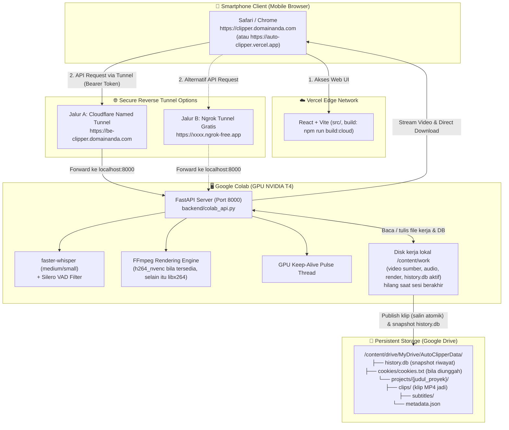

# ☁️ Panduan Teknis Lengkap: Menjalankan Auto Clipper Cloud

Dokumentasi ini merupakan panduan teknis resmi *end-to-end* untuk mengonfigurasi, mendeploy, dan mengoperasikan **Auto Clipper Cloud secara mandiri (*self-hosted*)**.

Dengan panduan ini, Anda dapat menjalankan seluruh proses berat (transkripsi suara dengan Whisper, *face tracking*, pembuatan kanvas dinamis, dan *rendering* video FFmpeg) di **Google Colab (T4 GPU Gratis)** dengan penyimpanan persisten di **Google Drive**, serta mengontrolnya langsung dari **Web App Smartphone (Vercel)**.

Transkripsi Whisper memakai GPU T4. Notebook memasang FFmpeg standar dari Ubuntu, jadi render memakai encoder GPU (`h264_nvenc`) hanya bila runtime Colab menyediakannya; bila tidak, render berjalan di CPU (`libx264`). Encoder yang benar-benar dipakai tertulis di Pemeriksaan awal (Langkah 3.4) dan di "Detail waktu" setiap job.

> [!NOTE]
> **Pilihan Metode Konektivitas (Pilih Sesuai Kebutuhan Anda):**
> 1. **Jalur A (Rekomendasi jika Punya Domain Pribadi):** Menggunakan **Cloudflare Zero Trust Named Tunnel** (`be-clipper.domainanda.com`) + Custom Domain di Vercel (`clipper.domainanda.com`).
> 2. **Jalur B (100% Gratis Tanpa Punya Domain):** Menggunakan **Ngrok Tunnel** (`https://xxxx.ngrok-free.app`) + Domain default gratis Vercel (`https://auto-clipper-web-xxxx.vercel.app`).

---

## 📑 Daftar Isi

1. [Ikhtisar & Arsitektur Sistem](#1-ikhtisar--arsitektur-sistem)
   - [Diagram Aliran Data & Topologi](#diagram-aliran-data--topologi)
   - [Keunggulan Mode Cloud](#keunggulan-mode-cloud)
2. [Prasyarat & Persiapan Akun (One-Time Setup)](#2-prasyarat--persiapan-akun-one-time-setup)
3. [Setup Backend Cloud (Google Colab & Google Drive)](#3-setup-backend-cloud-google-colab--google-drive)
   - [Langkah 3.1: Membuka Notebook Colab](#langkah-31-membuka-notebook-colab)
   - [Langkah 3.2: Mengaktifkan Akselerator Hardware T4 GPU](#langkah-32-mengaktifkan-akselerator-hardware-t4-gpu)
   - [Langkah 3.3: Mounting Google Drive & Struktur Workspace](#langkah-33-mounting-google-drive--struktur-workspace)
   - [Langkah 3.4: Eksekusi Server & Mekanisme GPU Keep-Alive](#langkah-34-eksekusi-server--mekanisme-gpu-keep-alive)
   - [Langkah 3.5: Verifikasi Health Check Backend](#langkah-35-verifikasi-health-check-backend)
4. [Setup Konektivitas Tunnel Publik](#4-setup-konektivitas-tunnel-publik)
   - [Jalur A: Cloudflare Zero Trust Tunnel (Jika Punya Domain Sendiri)](#jalur-a-cloudflare-zero-trust-tunnel-jika-punya-domain-sendiri)
   - [Jalur B: Ngrok Tunnel Gratis (Jika Tidak Punya Domain)](#jalur-b-ngrok-tunnel-gratis-jika-tidak-punya-domain)
5. [Setup & Deployment Frontend Web ke Vercel](#5-setup--deployment-frontend-web-ke-vercel)
   - [Langkah 5.1: Import Repositori ke Vercel](#langkah-51-import-repositori-ke-vercel)
   - [Langkah 5.2: Konfigurasi Root Directory & Build Settings](#langkah-52-konfigurasi-root-directory--build-settings)
   - [Langkah 5.3: Pengaturan Environment Variable (VITE_API_URL)](#langkah-53-pengaturan-environment-variable-vite_api_url)
   - [Langkah 5.4: Pengaturan Domain Frontend (Custom Domain vs Default Vercel)](#langkah-54-pengaturan-domain-frontend-custom-domain-vs-default-vercel)
6. [SOP Pengoperasian Harian via Smartphone](#6-sop-pengoperasian-harian-via-smartphone)
   - [Langkah 0: Masuk](#langkah-0-masuk)
   - [Langkah 1: Video](#langkah-1-video)
   - [Langkah 2: Siapkan](#langkah-2-siapkan)
   - [Langkah 3: Pilih momen](#langkah-3-pilih-momen)
   - [Langkah 4: Klip dan Unduh](#langkah-4-klip-dan-unduh)
   - [Pilih ulang momen (tanpa API key)](#pilih-ulang-momen-tanpa-api-key)
   - [Riwayat dan Pengaturan](#riwayat-dan-pengaturan)
7. [Panduan Pemeliharaan, Troubleshooting & FAQ](#7-panduan-pemeliharaan-troubleshooting--faq)
   - [Kendala 1: Sesi Google Colab Terputus / Idle Timeout](#kendala-1-sesi-google-colab-terputus--idle-timeout)
   - [Kendala 2: Muncul "Kode akses ditolak" atau "Kode akses tidak berlaku lagi"](#kendala-2-muncul-kode-akses-ditolak-atau-kode-akses-tidak-berlaku-lagi)
   - [Kendala 3: Error CORS atau Network Connection Failed](#kendala-3-error-cors-atau-network-connection-failed)
   - [Kendala 4: Memory GPU Penuh (OOM) & Fallback Otomatis NVENC](#kendala-4-memory-gpu-penuh-oom--fallback-otomatis-nvenc)
   - [Kendala 5: Manajemen & Pembersihan Kapasitas Google Drive](#kendala-5-manajemen--pembersihan-kapasitas-google-drive)
   - [Kendala 7: "YouTube meminta verifikasi"](#kendala-7-youtube-meminta-verifikasi-sign-in-to-confirm-youre-not-a-bot--http-403)
   - [Kendala 8: Job Tertahan dengan Tulisan "Menunggu giliran"](#kendala-8-job-tertahan-dengan-tulisan-menunggu-giliran)
   - [Kendala 9: "Google Drive belum terhubung"](#kendala-9-google-drive-belum-terhubung)
   - [Kendala 10: "Bahan proyek lama sudah tidak ada" saat Pilih ulang momen](#kendala-10-bahan-proyek-lama-sudah-tidak-ada-saat-pilih-ulang-momen)

---

## 1. Ikhtisar & Arsitektur Sistem

Auto Clipper Cloud memisahkan antarmuka pengguna (*Frontend*) dengan mesin komputasi berat (*Backend*). Pengguna mengontrol alur kerja dari browser smartphone (iOS Safari / Android Chrome) yang di-host di Vercel, sementara pemrosesan AI dan video dioperasikan di VM Google Colab yang dilengkapi GPU NVIDIA T4.

### Diagram Aliran Data & Topologi



### Keunggulan Mode Cloud

1. **Bebas Kebutuhan Spesifikasi Komputer**: Tidak memerlukan PC gaming atau kartu grafis mahal. Cukup gunakan HP dengan koneksi internet.
2. **GPU T4 Gratis untuk Transkripsi**: Whisper berjalan di GPU, jauh lebih cepat daripada di CPU. Render klip memakai GPU hanya bila runtime menyediakan encoder `h264_nvenc` (lihat Pemeriksaan awal).
3. **Disk Kerja Cepat, Hasil Aman di Drive**: Selama job berjalan, semua file dikerjakan di disk lokal Colab (`/content/work`). Setiap klip yang selesai langsung disalin ke Google Drive, dan riwayat (`history.db`) dicadangkan ke Drive. Jika sesi Colab terputus, klip jadi dan riwayat tetap ada, dan job bisa dilanjutkan (*resume*); video sumber diunduh ulang bila diperlukan.
4. **Alur Kerja Asinkron (*Bebas Tutup Browser*)**: Saat FFmpeg merender klip di Colab, Anda dapat menutup browser smartphone dan melakukan aktivitas lain. Ketika browser dibuka kembali, sistem akan menyinkronkan status secara otomatis.

---

## 2. Prasyarat & Persiapan Akun (One-Time Setup)

Sebelum menjalankan Auto Clipper Cloud untuk pertama kali, siapkan akun dan token berikut:

| Komponen | Kegunaan | Biaya | Pendaftaran |
|---|---|---|---|
| **Akun Google** | Akses Google Colab & Google Drive | Gratis (15 GB) | [google.com](https://google.com) |
| **Akun GitHub** | Repository hosting kode Auto Clipper | Gratis | [github.com](https://github.com) |
| **Akun Vercel** | Hosting antarmuka Frontend Web | Gratis (Hobby Tier) | [vercel.com](https://vercel.com) |
| **Cloudflare Zero Trust** *(Jalur A)* | Tunnel aman jika punya custom domain | Gratis (Free Tier) | [dash.cloudflare.com](https://dash.cloudflare.com) |
| **Akun Ngrok** *(Jalur B)* | Tunnel instan jika tidak punya domain | Gratis (Free Tier) | [ngrok.com](https://ngrok.com) |

> [!IMPORTANT]
> **Tentukan Static API Secret Token Anda:**
> Siapkan sebuah kata sandi rahasia yang kuat (misalnya: `rahasia-saya-2026-xyz`). Token ini akan digunakan bersama antara Colab Backend (`API_SECRET_TOKEN`) dan Web App di HP Anda untuk mencegah akses tanpa izin dari publik.

---

## 3. Setup Backend Cloud (Google Colab & Google Drive)

### Langkah 3.1: Membuka Notebook Colab

1. Buka [Google Colab](https://colab.research.google.com/).
2. Pilih tab **GitHub**, masukkan URL repository Anda (atau upload file [`Auto_Clipper_Colab.ipynb`](../Auto_Clipper_Colab.ipynb)).
3. Buka file **`Auto_Clipper_Colab.ipynb`**.

### Langkah 3.2: Mengaktifkan Akselerator Hardware T4 GPU

1. Pada menu navigasi Colab, klik **Runtime** → **Change runtime type** (*Ubah jenis runtime*).
2. Di bagian **Hardware accelerator**, pilih **T4 GPU**.
3. Pastikan indikator **GPU RAM** muncul di status bar kanan atas.

> [!WARNING]
> Jika runtime berjalan pada mode standard **CPU**, transkripsi Whisper berjalan jauh lebih lambat. Pemeriksaan awal di Langkah 3.4 menandainya dengan `[PERHATIAN] GPU tidak aktif`.

### Langkah 3.3: Menghubungkan Google Drive & Mempersiapkan Ruang Kerja

Di Google Colab, setiap instruksi kode berada di dalam **kotak eksekusi**. Anda cukup mengklik **tombol Play (▶️)** di sebelah kiri masing-masing kotak:

1. **Hubungkan Google Drive (Kotak Bagian 1):**
   - Klik tombol **Play (▶️)** pada bagian **`1. Mount Google Drive`**.
   - Colab akan menampilkan tombol persetujuan *"Connect to Google Drive"*. Klik tombol tersebut dan izinkan akses akun Google Anda.
   
   Setelah terhubung, Auto Clipper memakai dua tempat penyimpanan:
   ```text
   Disk kerja lokal Colab: /content/work/        # cepat, HILANG saat sesi berakhir
   ├── history.db                  # Database riwayat yang sedang dipakai server
   ├── temp_downloads/             # Video yang diunggah langsung lewat /upload
   └── projects/{judul_proyek}/
       ├── source/                 # Video asli (unduhan atau salinan dari Drive)
       ├── subtitles/              # Transkrip kata & subtitle kerja
       └── clips/                  # Klip yang sedang dirender

   Google Drive Saya / AutoClipperData /         # permanen (pustaka)
   ├── history.db                  # Snapshot riwayat: status akhir job langsung, perubahan lain maks. 1x per 5 detik
   ├── cookies/cookies.txt         # Hanya bila Anda mengunggah cookies YouTube
   └── projects/{judul_proyek}/
       ├── clips/                  # Klip video hasil render siap unduh
       ├── subtitles/              # Transkrip kata & subtitle hasil edit
       └── metadata.json           # Ringkasan job (tanpa API key)
   ```

   Video sumber tidak disalin ke Drive. Bila sesi berakhir lalu job dilanjutkan atau dirender ulang, video dari URL diunduh ulang dan video yang dipilih dari Google Drive disalin ulang dari Drive. Video yang diunggah langsung harus diunggah lagi.

### Langkah 3.4: Memasang Program & Menjalankan Server Backend

2. **Pemasangan Otomatis (Kotak Bagian 2 & 3):**
   - Klik tombol **Play (▶️)** pada bagian **`2. Pasang Sistem & Dependensi (FFmpeg, Cloudflared & Deno)`** (untuk memasang FFmpeg, cloudflared, dan Deno). Deno dipasang dengan skrip resmi (`curl -fsSL https://deno.land/install.sh | DENO_INSTALL=/usr/local sh`) ke `/usr/local/bin`, sehingga server menemukannya di `PATH`. Bila pemasangan gagal, kotak menulis `PERHATIAN: Deno tidak berhasil dipasang` dan langkah berikutnya tetap bisa dijalankan; unduhan YouTube hanya menjadi kurang andal.
   - Klik tombol **Play (▶️)** pada bagian **`3. Unduh Program Auto Clipper & Dependensi Python`**. Kotak ini mengunduh kode Auto Clipper dari cabang `BRANCH` (biarkan `main`), memasang library Python, dukungan GPU untuk subtitle, dan pelacak wajah **Teliti** (MediaPipe 1.2.3, SHA-256 terkunci). Bila kotak ini dilewati, pilihan Teliti memakai cara Standar dan layar progres memberi tahu caranya.
   - Tunggu proses instalasi selesai (ditandai dengan centang hijau ✅ di samping tombol Play).

3. **Menjalankan Server (Kotak Bagian 4):**
   Pilih salah satu formulir sesuai jalur yang Anda gunakan:

#### Jika Memilih Jalur A (Cloudflare Named Tunnel - Punya Domain Sendiri):
Isi kolom formulir pada kotak **`4A. Jalankan Backend (Pilihan A: Cloudflare Tunnel - Punya Domain Sendiri)`**:
- **`CLOUDFLARE_TUNNEL_TOKEN`**: Tempel token tunnel Cloudflare Anda.
- **`API_SECRET_TOKEN`**: Masukkan password rahasia yang Anda tentukan sendiri.
- Klik tombol **Play (▶️)** untuk mulai menjalankan server.

#### Jika Memilih Jalur B (Ngrok Tunnel - 100% Gratis Tanpa Domain):
Isi kolom formulir pada kotak **`4B. Jalankan Backend (Pilihan B: Ngrok Tunnel - 100% Gratis Tanpa Domain)`**:
- **`NGROK_AUTHTOKEN`**: Tempel authtoken akun Ngrok gratis Anda.
- **`API_SECRET_TOKEN`**: Masukkan password rahasia yang Anda tentukan sendiri.
- Klik tombol **Play (▶️)**.
- Tunggu beberapa detik, Colab akan mencetak URL publik Anda dengan format:
  ```text
  🚀 PUBLIC BACKEND URL ANDA: https://abcd-12-34-56.ngrok-free.app
  ```
  *(Salin URL ini untuk dimasukkan ke Vercel).*

> [!TIP]
> **💡 Cara Paling Cepat (*Run All*):**
> Anda juga bisa langsung mengisi token di formulir Bagian 4 terlebih dahulu, lalu klik menu **Runtime** di bagian atas layar Colab → pilih **Run all** (atau tekan shortcut `Ctrl + F9` di Windows / `Cmd + F9` di Mac). Seluruh proses dari nomor 1 sampai 4 akan berjalan otomatis!

#### Pemeriksaan Awal (Preflight)
Kedua kotak Bagian 4 mengatur `AUTO_CLIPPER_WORKSPACE=/content/drive/MyDrive/AutoClipperData` (pustaka di Drive) dan `AUTO_CLIPPER_WORK_DIR=/content/work` (disk kerja lokal), lalu menjalankan `python scripts/colab_preflight.py` sebelum server menyala. Skrip itu menjalankan pemeriksaan yang sama dengan endpoint `GET /api/preflight` (FFmpeg, ruang disk, RAM, GPU, encoder GPU, Google Drive, Deno, umur yt-dlp) dan mencetak tiap hasil dalam bahasa Indonesia:

```text
[OK] Pengolah video siap
    Program pengolah video ditemukan.
[PERHATIAN] Klip dibuat dengan prosesor
    Kartu grafis di perangkat ini tidak bisa dipakai untuk membuat klip, ...
```

`[PERHATIAN]` tidak menghentikan apa pun. `[MASALAH]` (FFmpeg tidak ada, disk hampir penuh, atau Google Drive belum terhubung) membuat setiap job berhenti sebelum mulai dengan pesan yang sama, sampai masalahnya diperbaiki. Skrip selalu selesai dengan kode 0 agar server tetap dijalankan.

#### Fitur Anti-Idle (*GPU Keep-Alive*):
Pada Jalur A (`backend/colab_api.py`), Auto Clipper menjalankan penjaga GPU (*keep-alive*) yang memberi aktivitas mikro pada memori GPU setiap 20 detik. Jalur B menjalankan `uvicorn` langsung tanpa penjaga ini. Fitur ini tidak menjamin Colab gratis tetap tersambung: batas waktu sesi dari Google tetap berlaku.

### Langkah 3.5: Memeriksa Status Server (Health Check)

Untuk memastikan server Anda sudah siap menerima perintah, buka tab baru di browser dan buka alamat:
- **Jalur A:** `https://be-clipper.domainanda.com/health`
- **Jalur B:** `https://xxxx.ngrok-free.app/health`

Jika berhasil, browser akan menampilkan teks:
```json
{"status": "ok"}
```
`/health` hanya menandakan server hidup. Keadaan GPU, encoder, Drive, dan Deno ada di hasil Pemeriksaan awal (Langkah 3.4) atau di `GET /api/preflight` (butuh header `Authorization: Bearer <API_SECRET_TOKEN>`).

---

## 4. Setup Konektivitas Tunnel Publik

Karena Google Colab berjalan di dalam jaringan internal Google yang tertutup, Anda memerlukan *reverse tunnel* agar browser HP dapat mengirim perintah ke backend FastAPI (port 8000).

---

### Jalur A: Cloudflare Zero Trust Tunnel (Jika Punya Domain Sendiri)

Gunakan metode ini jika Anda sudah memiliki domain pribadi (contoh: `domainanda.com`) yang terhubung ke Cloudflare:

1. Buka [Cloudflare Zero Trust Dashboard](https://one.dash.cloudflare.com/).
2. Masuk ke menu **Networks** → **Tunnels** → klik **Create a tunnel**.
3. Pilih tipe **Cloudflared**, beri nama tunnel (misal: `colab-clipper`), lalu klik **Save tunnel**.
4. Di bagian *Install and run a connector*, pilih tab **Debian (64-bit)** dan salin token tunnel (string panjang setelah `--token`).
5. Masuk ke tab **Public Hostname** pada tunnel tersebut, klik **Add a public hostname**:
   - **Subdomain:** `be-clipper` (atau `api`)
   - **Domain:** Pilih domain Anda yang aktif di Cloudflare (misal: `domainanda.com`)
   - **Path:** *(Biarkan kosong)*
   - **Type:** `HTTP`
   - **URL:** `127.0.0.1:8000` *(PENTING: Gunakan `127.0.0.1:8000`, JANGAN ketik `localhost:8000` agar cloudflared tidak mencoba dial IPv6 `[::1]` yang menyebabkan error connection refused).*
6. Klik **Save hostname**. Publik URL backend Anda sekarang adalah: `https://be-clipper.domainanda.com`.
7. Tempel token yang disalin ke kolom `CLOUDFLARE_TUNNEL_TOKEN` di notebook Colab.

---

### Jalur B: Ngrok Tunnel Gratis (Jika Tidak Punya Domain)

Gunakan metode ini jika Anda **tidak memiliki domain sendiri**. Seluruh proses 100% gratis:

1. Daftar akun di [ngrok.com](https://ngrok.com) dan buka halaman **Your Authtoken**.
2. Salin token autentikasi Ngrok Anda.
3. Tempel token tersebut ke notebook Colab (pada blok Ngrok di Langkah 3.4).
4. Saat sel dijalankan, Colab akan mencetak URL publik unik, contoh: `https://abcd-12-34-56.ngrok-free.app`.
5. Salin URL tersebut untuk dimasukkan ke konfigurasi Vercel di bab berikutnya.

---

## 5. Setup & Deployment Frontend Web ke Vercel

Frontend Web Auto Clipper memakai kode yang sama dengan aplikasi desktop (folder `src/`, **React 19 + Vite 8 + Tailwind CSS**) dan dibangun dengan `VITE_TARGET=cloud`.

### Langkah 5.1: Import Repositori ke Vercel

1. Buka dashboard [Vercel](https://vercel.com) dan klik **Add New...** → **Project**.
2. Hubungkan akun GitHub Anda dan pilih repositori `auto-clipper` (atau hasil fork Anda).

### Langkah 5.2: Konfigurasi Root Directory & Build Settings

Sejak v1.19.0 aplikasi web dibangun dari folder utama repositori. Setelan build ada di file `vercel.json`, jadi Anda cukup:
- **Project Name:** `auto-clipper-web` (atau sesuai preferensi Anda).
- **Root Directory:** biarkan kosong (folder utama). Jangan pilih folder `web` (folder itu sudah dihapus).
- **Framework Preset, Build Command, Output Directory, Install Command:** biarkan bawaan. Vercel memakai isi `vercel.json`: `vite`, `npm run build:cloud`, `dist`, `npm ci`.
- **Node.js Version** (Settings → Build and Deployment): `22.x`.

> [!IMPORTANT]
> **Proyek Vercel lama (Root Directory `web`):** buka **Settings → Build and Deployment**, kosongkan **Root Directory**, pilih Node.js **22.x**, simpan, lalu **Redeploy**. Tanpa langkah ini deploy berikutnya gagal karena folder `web` sudah tidak ada.

### Langkah 5.3: Pengaturan Environment Variable (`VITE_API_URL`)

Buka bagian **Environment Variables** di Vercel dan tambahkan variabel penunjuk backend:

| Nama Variabel | Contoh Nilai Jalur A (Domain Sendiri) | Contoh Nilai Jalur B (Ngrok Gratis) |
|---|---|---|
| `VITE_API_URL` | `https://be-clipper.domainanda.com` | `https://abcd-12-34-56.ngrok-free.app` |

> [!TIP]
> **Tidak Perlu Mengubah Kodingan:**
> File [`src/platform/cloud/index.ts`](../src/platform/cloud/index.ts) secara otomatis membaca `import.meta.env.VITE_API_URL`. Anda cukup mengisi variabel ini di Vercel Dashboard tanpa perlu mengotak-atik file kode di Git.
>
> *Catatan:* Jika Anda mengubah nilai `VITE_API_URL` di Vercel di kemudian hari (misal saat URL Ngrok berganti), buka tab **Deployments** → klik `...` pada deployment terakhir → pilih **Redeploy** agar Vite memperbarui bundle frontend.

### Langkah 5.4: Pengaturan Domain Frontend (Custom Domain vs Default Vercel)

1. **Jalur A (Menggunakan Custom Domain Frontend):**
   - Di Vercel, masuk ke **Settings** → **Domains**.
   - Tambahkan domain frontend, misal: `clipper.domainanda.com`.
   - Di DNS Manager Cloudflare Anda, tambahkan CNAME Record:
     - **Name:** `clipper`
     - **Target:** `cname.vercel-dns.com`
     - **Proxy status:** *DNS Only* (abu-abu).
2. **Jalur B (Menggunakan Domain Gratis Bawaan Vercel):**
   - Anda tidak perlu mengatur DNS apapun! Vercel otomatis memberikan URL gratis seperti: `https://auto-clipper-web-xxxx.vercel.app`.
   - Backend FastAPI Auto Clipper secara otomatis mengizinkan seluruh domain `*.vercel.app` tanpa konfigurasi tambahan.

---

## 6. SOP Pengoperasian Harian via Smartphone

Sejak v1.19.0 aplikasi web memakai kode yang sama dengan aplikasi desktop. Aplikasi punya tiga menu: **Buat klip** (`#/`), **Riwayat** (`#/riwayat`), dan **Pengaturan** (`#/pengaturan`). Di HP menu ada di bawah layar; dari lebar 768 px ke atas menu pindah ke sisi kiri. Alamat lama (`#/manual-ai`, `#/history`, `#/settings`, `#/downloader`, `#/help`) dialihkan otomatis.

Layar **Buat klip** memandu empat langkah: **1 Video → 2 Siapkan → 3 Pilih momen → 4 Klip**. Di cloud tidak ada API key: momen dipilih lewat ChatGPT atau Gemini yang Anda buka sendiri.

### Langkah 0: Masuk
1. Pastikan notebook Colab sudah berjalan sampai server menyala.
2. Buka alamat Vercel Anda di browser HP, isi **Kode akses** dengan `API_SECRET_TOKEN` dari notebook, lalu tekan **Masuk**. Kode disimpan di browser itu saja.
3. Saat aplikasi pertama kali dibuka di tab itu, layar pembuka (logo, nama, tagline, versi) tampil sebentar sampai sambungan ke Colab diperiksa, paling lama 2,5 detik. Di bawah kotak kode akses ada tautan media sosial Auto Clipper dan baris hak cipta.

### Langkah 1: Video
1. Tempel link di kotak **Tempel link YouTube, TikTok, atau Instagram**, atau tekan **Pilih dari Google Drive** (video di Drive) atau **Pilih file video** (diunggah ke disk kerja Colab, hilang saat sesi berakhir).
2. Pilih **Bentuk klip** (Vertikal, Persegi, Lebar). Pilihan lain ada di **Atur tampilan klip** (tertutup bawaan) dan diingat untuk video berikutnya. **Nama proyek** boleh kosong; judul dibuat dari video dan waktu sekarang.
3. Layar memanggil `GET /api/preflight` saat dibuka. Hasil `warn` tampil di **Catatan sebelum mulai**; hasil `block` tampil sebagai kartu error dan tombol **Mulai** nonaktif sampai **Periksa lagi** lolos.
4. Tekan **Mulai**.

### Langkah 2: Siapkan
Layar progres menampilkan tahap nyata dari objek `current` di `GET /jobs/{id}`: **Mengunduh video** (dengan persen bila yt-dlp melaporkannya), **Mengambil suara dari video**, **Membuat subtitle**. Tahap selesai bercentang dengan lamanya. Bila subtitle dibuat dengan CPU, muncul catatan "Subtitle dibuat dengan prosesor, bukan GPU." Di cloud layar menulis bahwa halaman boleh ditutup: job tetap berjalan di Colab. **Batalkan** menghentikan job setelah konfirmasi.

### Langkah 3: Pilih momen
1. Tekan **Salin perintah** (transkrip dan petunjuk untuk AI).
2. Tekan **Buka ChatGPT** atau **Buka Gemini**, tempel perintahnya, lalu kirim.
3. Salin seluruh jawaban AI, tempel di **Tempel jawaban AI di sini**, lalu tekan **Buat klip**. Jawaban diperiksa sebelum dikirim; jawaban terpotong, kosong, atau bukan jawaban AI ditolak dengan pesan di bawah kotak.
4. Proyek yang belum diberi jawaban tersimpan di **Riwayat** dengan status **Menunggu jawaban AI** dan tombol **Tempel jawaban AI**.

### Langkah 4: Klip dan Unduh
1. Klip dibuat di Colab (`AUTO_CLIPPER_MAX_HEAVY_JOBS`, bawaan 1 job berat dalam satu waktu). Layar progres menampilkan **Membuat klip 3 dari 10** dan seterusnya; antrean tampil sebagai "Menunggu giliran. Urutan ke-N."
2. Setiap klip punya pemutar, **Unduh**, **Bagikan** (judul, deskripsi, tagar), dan menu titik tiga (**Ubah subtitle atau tampilan**). **Unduh semua** mengunduh klip satu per satu lewat browser. **Detail waktu** ada di bawah daftar klip.
3. Bila job gagal, kartu error menampilkan judul, penjelasan, dan tombol aksi (**Lanjutkan**, **Unggah cookies.txt**, **Pilih video dari Google Drive**); pesan mentah ada di **Detail teknis** dengan tombol **Salin**.

### Pilih ulang momen (tanpa API key)
Proyek yang sudah selesai bisa dipilih ulang momennya tanpa membuat subtitle lagi:
1. Buka **Riwayat**, tekan tombol titik tiga pada proyeknya, lalu **Pilih ulang momen**. Menu ini muncul untuk proyek berstatus Selesai yang teks ucapannya masih tersimpan.
2. Isi **Apa yang mau diubah?** (boleh kosong, misalnya "cari bagian yang lucu saja") dan, bila perlu, **Jumlah klip** (kosongkan agar AI yang menentukan). Tekan **Lanjut**.
3. Aplikasi membuat proyek baru bernama "<judul lama> (pilihan ulang)" dan langsung membuka langkah **3 Pilih momen** dengan perintah baru. Lanjutkan seperti biasa: **Salin perintah**, tempel di ChatGPT atau Gemini, tempel jawabannya di **Tempel jawaban AI di sini**, lalu **Buat klip**.
4. Klip proyek lama tetap ada. Di belakang layar aplikasi memanggil `POST /jobs/{id}/rerun-manual`; teks ucapan dibaca dari Google Drive. Bila sesi Colab sudah berganti, video dari link diunduh ulang saat jawaban ditempel (subtitle tidak dibuat ulang). Video yang dipilih dari Google Drive disalin ulang dari Drive.

### Riwayat dan Pengaturan
- **Riwayat** menampilkan judul, tanggal, status (Selesai, Gagal, Menunggu jawaban AI, Sedang diproses, Menunggu giliran, Dibatalkan), dan jumlah klip, dengan satu tombol utama: **Lihat klip**, **Tempel jawaban AI**, **Lihat progres**, **Lanjutkan**, atau **Coba lagi**. Menu titik tiga: **Buat ulang semua klip**, **Pilih ulang momen**, dan **Hapus** (dengan konfirmasi).
- **Pengaturan** punya empat bagian: **Umum** (tema, bahasa), **YouTube** (cookies), **Lanjutan** (cara mengikuti wajah, kualitas unduhan, model subtitle, **Unduh video tanpa membuat klip**), dan **Bantuan** (`#/pengaturan#bantuan`: **Tentang Auto Clipper** dengan versi, tautan media sosial dan tombol **Dukung pembuat aplikasi**, lalu langkah singkat, pertanyaan umum, dan **Detail teknis**). Pilihan **AI otomatis dengan API key** hanya ada di desktop dan web lokal.
- Di bawah setiap halaman ada satu baris kecil berisi hak cipta dan versi aplikasi.

---

## 7. Panduan Pemeliharaan, Troubleshooting & FAQ

### Kendala 1: Sesi Google Colab Terputus / Idle Timeout
* **Penyebab:** Google Colab gratis memiliki batas durasi maksimal sesi kontinu dan dapat terputus jika tidak ada aktivitas tab dalam waktu lama.
* **Solusi & Mitigasi:**
  1. Klip yang telah selesai dirender, file subtitle, dan snapshot `history.db` ada di Google Drive. Disk kerja `/content/work` (video sumber, file sementara, `history.db` aktif) hilang.
  2. Buka notebook Colab kembali, klik **Connect / Reconnect**, lalu jalankan kembali seluruh sel (**Run All**). Saat server menyala tanpa `history.db` lokal, snapshot dari Drive dipulihkan otomatis.
  3. Buka Web App di HP Anda: riwayat job muncul kembali. Job yang terputus di tengah jalan bisa dilanjutkan dengan **Lanjutkan**; video sumber dari URL diunduh ulang, video dari Google Drive disalin ulang, dan video yang diunggah langsung harus diunggah lagi (pesan "File video yang diunggah sudah tidak ada").
  4. Batasan: perubahan tahap dalam ±5 detik terakhir sebelum runtime mati bisa belum masuk snapshot, sehingga job tampil di tahap sebelumnya. Klip yang sedang dirender saat itu dibuat ulang ketika job dilanjutkan.

---

### Kendala 2: Muncul "Kode akses ditolak" atau "Kode akses tidak berlaku lagi"
* **Penyebab:** Kode akses yang diketik di HP tidak sama dengan `API_SECRET_TOKEN` di sel Colab, atau server Colab dinyalakan ulang dengan kode lain.
* **Solusi:** Salin lagi kode dari sel Colab, tempel di kotak **Kode akses**, lalu tekan **Masuk**. Layar kode akses muncul sendiri, tidak perlu menghapus data browser.

---

### Kendala 3: Error CORS atau Network Connection Failed
* **Penyebab:** Request dari domain frontend diblokir oleh backend, atau tunnel Cloudflare/Ngrok sedang offline.
* **Solusi:**
  1. Pastikan sel backend Colab sedang aktif dan tidak berhenti dengan error.
  2. Uji endpoint `/health` backend di browser untuk memastikan tunnel aktif.
  3. Backend Auto Clipper secara bawaan sudah mengizinkan seluruh domain `*.vercel.app` dan localhost.
  4. Jika Anda menggunakan domain kustom sendiri di luar vercel.app, pastikan Anda telah men-set environment variable `AUTO_CLIPPER_CORS_ORIGIN` di Colab:
     ```python
     os.environ["AUTO_CLIPPER_CORS_ORIGIN"] = "https://clipper.domainanda.com"
     ```

---

### Kendala 4: Memory GPU Penuh (OOM) & Fallback Otomatis NVENC
* **Penyebab:** Video input memiliki resolusi sangat tinggi (4K/60fps) atau durasi transkripsi sangat panjang.
* **Solusi:**
  1. Auto Clipper menguji encoder `h264_nvenc` sekali. Jika tidak tersedia atau gagal, render memakai `libx264` di CPU. Peralihan ini tidak lagi diam-diam: Pemeriksaan awal menulis `[PERHATIAN] Klip dibuat dengan prosesor`, dan "Detail waktu" mencatat encoder yang dipakai tiap job.
  2. Untuk transkripsi video panjang di atas 1 jam, gunakan model Whisper `small` atau `medium` yang ramah memori.

---

### Kendala 5: Manajemen & Pembersihan Kapasitas Google Drive
* **Penyebab:** Klip MP4 hasil render menumpuk dan menghabiskan kuota 15 GB Google Drive seiring berjalannya waktu. (Dengan disk kerja lokal, video sumber tidak lagi disimpan ke Drive. Folder proyek dari versi lama masih bisa berisi video sumber.)
* **Solusi Pembersihan:**
  1. Buka Google Drive Anda di browser → buka folder `AutoClipperData` → `projects`.
  2. Hapus subfolder job proyek lama yang sudah selesai diunduh ke HP.
  3. **Jangan menghapus** file `history.db` jika Anda ingin tetap mempertahankan daftar riwayat klip di aplikasi web.
  4. Kosongkan *Trash / Sampah* di Google Drive Anda untuk membebaskan ruang penyimpanan secara permanen.

---

### Kendala 6: Cloudflared Error "Unable to reach the origin service ... dial tcp [::1]:8000: connect: connection refused"
* **Penyebab:**
  1. Di Cloudflare Zero Trust Dashboard, Service URL diset ke `localhost:8000`. Di Linux (Google Colab), `localhost` otomatis me-resolve ke alamat IPv6 loopback `[::1]`. Karena Uvicorn secara default hanya mengikat (*bind*) ke antarmuka IPv4 (`0.0.0.0:8000` / `127.0.0.1:8000`), koneksi IPv6 `[::1]` langsung ditolak (*connection refused*) oleh kernel.
  2. Server FastAPI/Uvicorn belum selesai booting saat tunnel mulai menerima traffic, atau proses Uvicorn terhenti.
* **Solusi:**
  1. Buka [Cloudflare Zero Trust Dashboard](https://one.dash.cloudflare.com/) → **Networks** → **Tunnels** → pilih tunnel Anda → **Configure** → tab **Public Hostname**.
  2. Klik **Edit** pada hostname backend Anda (misal: `be-clipper.domainanda.com`).
  3. Ubah kolom **URL** dari `localhost:8000` menjadi **`127.0.0.1:8000`**, lalu klik **Save hostname**.
  4. Untuk memverifikasi apakah server backend di Colab sudah benar-benar hidup, jalankan perintah ini di sel Colab baru:
     ```bash
     !curl -I http://127.0.0.1:8000/health
     ```
     Jika mengembalikan `HTTP/1.1 200 OK` dengan status JSON `{"status": "ok"}`, server Anda telah aktif dan siap menerima request!

---

### Kendala 7: "YouTube meminta verifikasi" (Sign in to confirm you're not a bot / HTTP 403)
* **Penyebab:** YouTube mencurigai permintaan dari alamat IP server Colab dan meminta login. Video dengan batasan umur juga memicunya.
* **Cara kerja pengunduh:** yt-dlp mencoba pilihan client bawaannya, lalu `web_embedded`, lalu `android_vr`, masing-masing sekali. Bila Deno ada di `PATH`, yt-dlp memakainya untuk menjawab tantangan JavaScript YouTube dan mengambil skrip pemecahnya (EJS) dari rilis GitHub `yt-dlp/ejs` (`remote_components=ejs:github`, diverifikasi dengan hash). Error yang tidak bisa ditolong client lain (video privat/terhapus, rate limit, disk penuh) langsung dihentikan.
* **Solusi 1: Unggah `cookies.txt`** dari akun YouTube **cadangan** (bukan akun utama, karena akun yang cookies-nya dipakai bisa dibatasi YouTube):
  1. Di browser komputer, pasang ekstensi "Get cookies.txt LOCALLY".
  2. Buka youtube.com, login dengan akun cadangan.
  3. Di tab itu, klik ikon ekstensi, pilih Export, lalu unggah filenya lewat tombol **Unggah cookies.txt** di kartu error atau lewat menu **Pengaturan**, bagian **YouTube**, di Web UI.

  Backend memvalidasi file (format Netscape, ada cookie `youtube.com`, belum kedaluwarsa, maks. 1 MB) dan menyimpannya di `<AUTO_CLIPPER_WORKSPACE>/cookies/cookies.txt`, yang di Colab berarti folder `AutoClipperData/cookies/` di Google Drive. yt-dlp hanya menerima salinan sementara di folder temp sistem yang dihapus setelah unduhan; isi cookie tidak pernah ditulis ke log atau dikirim ke Web UI (`GET /api/settings/cookies` hanya mengembalikan status dan tanggal berlaku). Bila YouTube tetap menolak walau cookies sudah dipakai, unduhan langsung dihentikan tanpa mencoba ulang, demi melindungi akun.
* **Solusi 2: Pakai file video.** Unduh video sendiri, simpan ke Google Drive, lalu pilih lewat **Pilih video dari Google Drive** di kartu error, atau tekan **Pilih dari Google Drive** di langkah 1 layar **Buat klip**.

---

### Kendala 8: Job Tertahan dengan Tulisan "Menunggu giliran"
* **Penyebab:** Backend memegang satu slot untuk tahap berat (transkripsi, tracking, render). Job berikutnya menunggu di antrean FIFO sampai job sebelumnya selesai, gagal, atau dibatalkan. Ini mencegah dua Whisper atau dua render berjalan bersamaan di RAM Colab.
* **Solusi:** Tidak perlu tindakan. Job yang masih menunggu bisa dibatalkan dan langsung keluar dari antrean. Menekan Lanjutkan berulang kali tidak mempercepat apa pun dan akan ditolak dengan pesan "Proyek ini masih diproses".

---

### Kendala 9: "Google Drive belum terhubung"
* **Penyebab:** Server (Bagian 4) dijalankan sebelum Google Drive di-mount (Bagian 1). Tanpa mount, `/content/drive/MyDrive/AutoClipperData` hanya folder di disk sementara Colab: klip yang disimpan di sana hilang bersama runtime. Karena itu backend menolak setiap job dengan kode `DRIVE_NOT_MOUNTED` (Pemeriksaan awal menandainya `[MASALAH]`) dan tidak membuat apa pun di bawah `/content/drive`. Selama Drive belum terhubung, log dan `history.db` ditulis ke `/content/work`.
* **Solusi:** Hentikan kotak Bagian 4, jalankan Bagian 1, lalu jalankan lagi Bagian 4.
* **Bila Bagian 1 gagal dengan `Mountpoint must not already contain files`:** versi lama Auto Clipper sempat membuat folder di `/content/drive` sebelum Drive di-mount, dan Colab hanya mau me-mount ke folder kosong. Buka menu **Runtime** → **Disconnect and delete runtime**, lalu jalankan semua kotak dari awal. Jangan menghapus folder `/content/drive` dengan perintah: bila Drive ternyata sudah ter-mount, isi Drive Anda ikut terhapus.

---

### Kendala 10: "Bahan proyek lama sudah tidak ada" saat Pilih ulang momen
* **Penyebab:** teks ucapan proyek itu sudah tidak ada di Google Drive (folder proyek dihapus), atau videonya diunggah langsung dan file unggahan hilang saat sesi Colab berakhir. Backend menolak dengan kode `RERUN_SOURCE_MISSING`.
* **Solusi:** tekan **Buat proyek baru** di kartu itu, lalu buat proyek dari link videonya. Klip proyek lama tetap aman di Drive.

---

## 🎯 Kesimpulan

Dengan setup **Auto Clipper Cloud**, Anda memiliki studio klip video otomatis berbasis AI kelas profesional yang 100% mandiri, ditenagai infrastruktur cloud GPU gratis, dan dapat dioperasikan secara fleksibel di mana saja langsung dari genggaman smartphone Anda.
